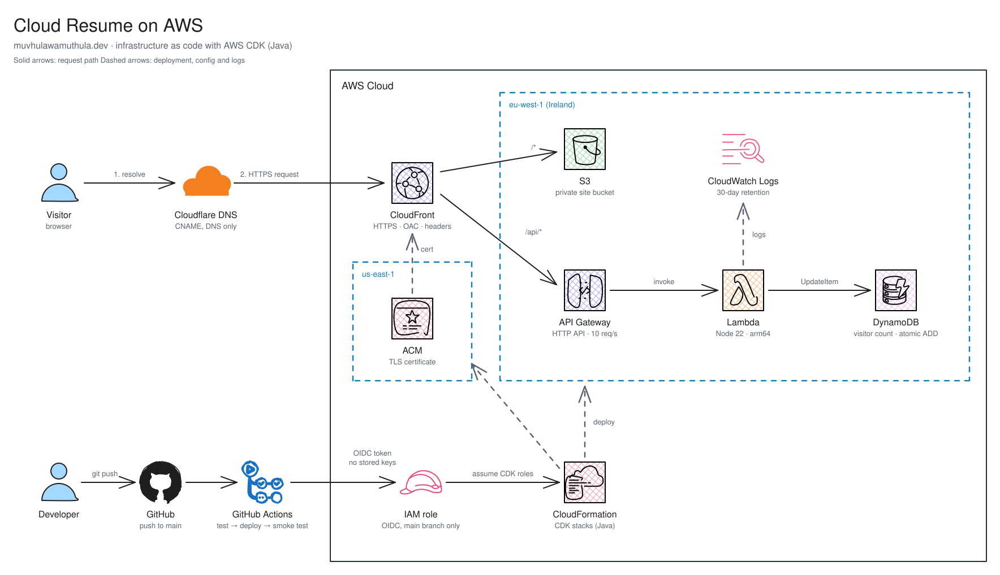

# Cloud Resume on AWS

[](https://github.com/muvhulawamuthula/azure-cloud-resume/actions/workflows/aws-cdk-deploy.yml)
[](https://muvhulawamuthula.dev)
-ff9900?logo=amazonaws&logoColor=white)
[](LICENSE)

My personal resume site, built for the [Cloud Resume Challenge](https://cloudresumechallenge.dev/).
It is a static site served globally through CloudFront, with a serverless visitor counter.
All of the infrastructure is defined in **Java with the AWS CDK** and deployed by GitHub Actions
on every push to `main`.

**Live:** https://muvhulawamuthula.dev

---

## Architecture



> The diagram is an [Excalidraw](https://excalidraw.com) scene drawn with the
> [AWS Architecture Icons](https://libraries.excalidraw.com/?theme=light#childishgirl-aws-architecture-icons)
> and [GitHub Actions](https://libraries.excalidraw.com/?theme=light#devdaejungyoon-github-actions)
> libraries. To edit it, open [`docs/architecture.excalidraw`](docs/architecture.excalidraw) in Excalidraw.

### How a request is served

1. **DNS:** `muvhulawamuthula.dev` and `www` are CNAME records on Cloudflare, set to *DNS only*.
   They point straight at the CloudFront distribution.
2. **Edge:** CloudFront terminates TLS with an ACM certificate issued in `us-east-1`. It redirects
   HTTP to HTTPS, redirects `www` to the root domain with a CloudFront Function, and adds security
   headers (HSTS, `X-Frame-Options`, `X-Content-Type-Options`, `Referrer-Policy`).
3. **Static content (`/*`):** files come from a private S3 bucket that only CloudFront can read,
   through Origin Access Control. Unknown paths fall back to `index.html`.
4. **Visitor counter (`/api/*`):** CloudFront forwards the request uncached to an API Gateway HTTP API,
   throttled to 10 requests/s with a burst of 20. The API invokes a Lambda function, which increments the
   count in DynamoDB with one atomic `ADD`, so concurrent visits are never lost. The API sits on the
   same domain as the site, so no CORS setup is needed.

---

## Tech stack

| Layer | Technology |
| --- | --- |
| Frontend | HTML, CSS, vanilla JavaScript |
| CDN and TLS | Amazon CloudFront, AWS Certificate Manager |
| Hosting | Amazon S3 (private, Origin Access Control) |
| API | Amazon API Gateway (HTTP API), AWS Lambda (Node.js 22, arm64) |
| Database | Amazon DynamoDB (on-demand, point-in-time recovery) |
| Observability | Amazon CloudWatch Logs (structured JSON, 30-day retention) |
| DNS | Cloudflare |
| Infrastructure as code | AWS CDK v2 in Java 21, built with Maven |
| CI/CD | GitHub Actions with GitHub OIDC to an AWS IAM role |
| Testing | JUnit 5 with CDK assertions, Jest |

---

## Repository layout

```
.
├── frontend/                 # Static site: index.html, styles.css, script.js
├── lambda/
│   ├── src/visitorCounter.js # Lambda handler (atomic DynamoDB counter)
│   └── test/                 # Jest unit tests
├── infra/                    # AWS CDK app (Java)
│   ├── cdk.json              # CDK config; context.domain sets the custom domain
│   └── src/
│       ├── main/java/com/myorg/
│       │   ├── AwsInfraApp.java       # Entry point: wires the stacks together
│       │   ├── ResumeSiteStack.java   # S3, CloudFront, API Gateway, Lambda, DynamoDB
│       │   ├── CertificateStack.java  # ACM certificate (us-east-1)
│       │   └── GitHubOidcStack.java   # OIDC provider and CI deploy role
│       └── test/java/com/myorg/       # CDK assertion tests
├── docs/                     # Architecture diagram (.excalidraw source and .svg export)
└── .github/workflows/
    └── aws-cdk-deploy.yml    # Test, deploy and smoke-test pipeline
```

---

## Infrastructure

The CDK app defines three stacks:

| Stack | Region | Contents |
| --- | --- | --- |
| `ResumeSiteStack` | `eu-west-1` | S3 bucket, CloudFront distribution and function, response headers policy, HTTP API, Lambda, DynamoDB table, log group, site upload with cache invalidation |
| `ResumeCertStack` | `us-east-1` | ACM certificate for the root domain and `www`, validated by DNS (CloudFront only accepts certificates from `us-east-1`) |
| `GitHubOidcStack` | `eu-west-1` | GitHub OIDC identity provider and the deploy role CI assumes |

The certificate reaches the site stack through CDK cross-region references. Without a `domain`
context value, the app deploys only `ResumeSiteStack`, served on its `*.cloudfront.net` address.

### Security

- **No long-lived credentials:** CI signs in through GitHub OIDC. The deploy role trusts only the
  `main` branch of this repository and can only assume the CDK bootstrap roles.
- **Least privilege:** the Lambda's role can call `dynamodb:UpdateItem` on one table and nothing else.
- **Private origin:** the S3 bucket blocks all public access and requires TLS. Only CloudFront can
  read from it.
- **Abuse protection:** API Gateway throttles the counter API.
- **Data safety:** the DynamoDB table is retained if the stack is deleted, and has point-in-time recovery.

---

## CI/CD

[`.github/workflows/aws-cdk-deploy.yml`](.github/workflows/aws-cdk-deploy.yml) runs when
`frontend/`, `lambda/` or `infra/` change:

| Trigger | Jobs |
| --- | --- |
| Pull request | `test`: Lambda Jest tests and CDK JUnit tests |
| Push to `main` | `test`, then `deploy`: assume the AWS role through OIDC, run `cdk deploy`, then smoke-test the live site and the counter API |

The pipeline reads one repository variable, `AWS_DEPLOY_ROLE_ARN`, which is the `DeployRoleArn`
output of `GitHubOidcStack`. It needs no secrets.

---

## Local development

### Prerequisites

- Java 21 and Maven 3.8+
- Node.js 22
- AWS CLI v2, with credentials for the target account
- AWS CDK CLI: `npm install -g aws-cdk`

### Run the tests

```bash
# Lambda unit tests
cd lambda && npm ci && npm test

# CDK unit tests
cd infra && mvn test
```

### Preview the site

The frontend is plain static files. Serve them locally with any web server:

```bash
cd frontend && python3 -m http.server 8000
```

The visitor counter shows **Unavailable** locally, because `/api/visitorCounter` exists only behind CloudFront.

### Deploy manually

```bash
cd infra
cdk diff                       # review changes first
cdk deploy ResumeCertStack ResumeSiteStack
```

---

## First-time setup

Do these once per AWS account. After that, the pipeline handles every deploy.

1. **Bootstrap CDK** in both regions:
   ```bash
   cdk bootstrap aws://<ACCOUNT_ID>/eu-west-1 aws://<ACCOUNT_ID>/us-east-1
   ```
2. **Create the CI role** and store its ARN for GitHub Actions:
   ```bash
   cd infra && cdk deploy GitHubOidcStack
   gh variable set AWS_DEPLOY_ROLE_ARN --body "<DeployRoleArn output>"
   ```
3. **Set the domain** in `infra/cdk.json` under `context.domain`, then run `cdk deploy ResumeCertStack`.
   While it waits, copy the validation CNAME records shown in the ACM console into Cloudflare
   as **DNS only** records. Keep them afterwards, because ACM uses them to renew the certificate.
4. **Deploy the site** with `cdk deploy ResumeSiteStack`.
5. **Point DNS at CloudFront:** in Cloudflare, create CNAME records for `@` and `www` that target
   the `CloudFrontDomain` output, with the proxy turned off (grey cloud).

---

## Background

The site first ran on Azure Static Web Apps, with an Azure Function and Table Storage behind it,
managed with Terraform. It has since moved to AWS. The infrastructure was rewritten in the AWS CDK
in Java, and the counter now uses an atomic DynamoDB update instead of a read-modify-write.

---

## License

[MIT](LICENSE) © 2026 Muvhulawa Vhofhololani Muthula
